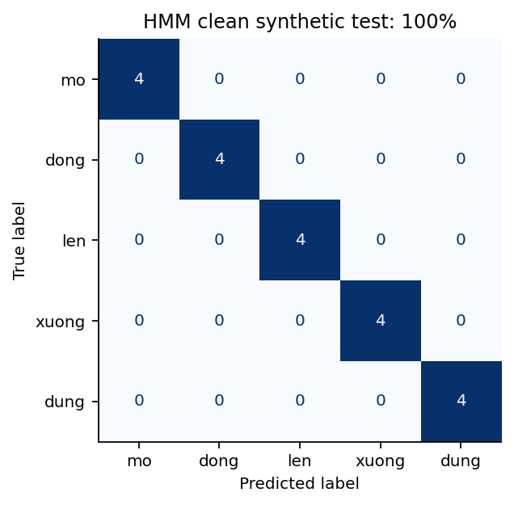
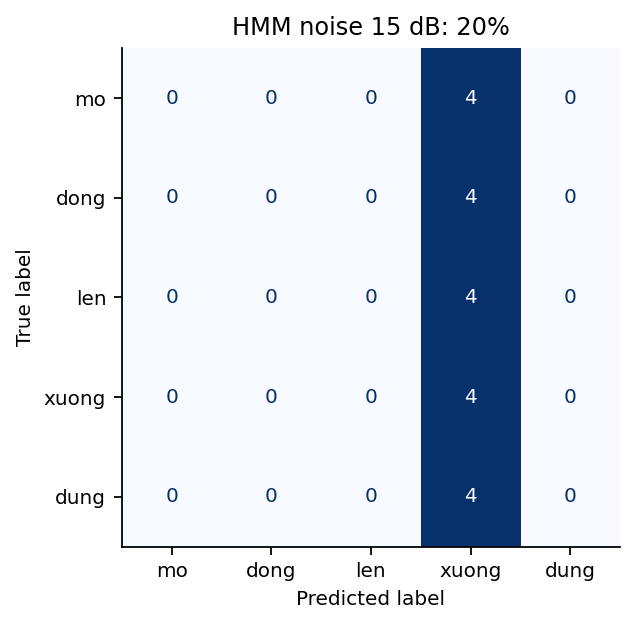
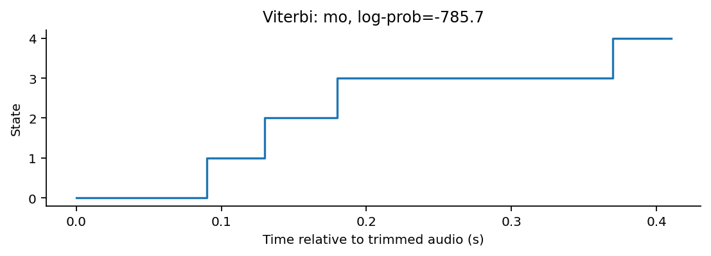
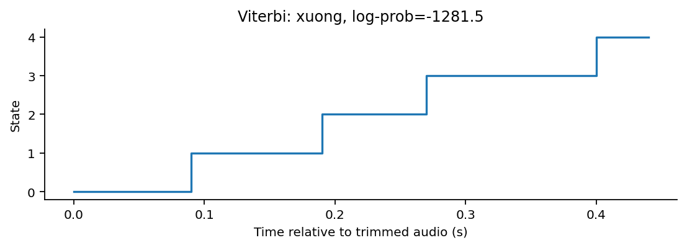

# Lab 03 – Nhận dạng tiếng nói nâng cao với HMM

**Học phần:** CSE457 – Xử lý âm thanh và tiếng nói, Đại học Thủy Lợi  
**Sinh viên:** Vũ Văn Đạt – **MSSV:** 2351260645

Hệ thống nhận dạng 5 lệnh tiếng Việt: **mở, đóng, lên, xuống, dừng** bằng whole-word Gaussian HMM. Bộ bài triển khai các phần A–H và thí nghiệm E1–E6 trong đề Lab 3.

> **Nguồn dữ liệu:** toàn bộ WAV được tổng hợp bằng eSpeak NG, không phải bản ghi người thật. Lexicon và corpus là bản minh họa tự soạn, chưa phải dữ liệu chuẩn do giảng viên cung cấp. Kết quả không chứng minh hiệu năng trên người nói thật.

## Mở nhanh

| Nội dung | Tệp / thư mục |
|---|---|
| Mã nguồn chính A–H, E1–E6 | [Lab03.py](Lab03.py) |
| Chạy toàn bộ và tạo báo cáo | [run_all.py](run_all.py) |
| Báo cáo 6 trang | [Bao_cao_Lab03.pdf](Bao_cao_Lab03.pdf) |
| Trả lời 10 câu hỏi | [CAU_HOI_BAO_CAO.md](CAU_HOI_BAO_CAO.md) |
| Đối chiếu yêu cầu đề | [DOI_CHIEU_YEU_CAU.md](DOI_CHIEU_YEU_CAU.md) |
| Hướng dẫn chi tiết | [HUONG_DAN_CHAY.md](HUONG_DAN_CHAY.md) |
| Dữ liệu âm thanh | [dataset/](dataset/) |
| Model đã huấn luyện | [models/](models/) |
| Kết quả và bảng số liệu | [results/](results/) |
| Nghe thử 5 lệnh | [Nghe_thu_5_lenh.wav](Nghe_thu_5_lenh.wav) |

## Chạy lại

Đã kiểm chứng bằng Python 3.12. Mở terminal tại thư mục Lab03:

```bash
python -m pip install -r requirements.txt
python run_all.py
```

Dùng WAV có sẵn thì không cần cài eSpeak NG. `run_all.py` chạy thí nghiệm, ghi `results/run.log` và tạo lại báo cáo PDF. Nếu chỉ cần chạy thực nghiệm, dùng `python Lab03.py`.

Nhận dạng một mẫu:

```bash
python Lab03.py --predict dataset/test/mo/mo_01.wav
```

Kết quả trả về log-likelihood của 5 lớp, nhãn closed-set và nhãn sau reject. **Log-likelihood không phải phần trăm độ tin cậy.**

## Dữ liệu

| Tập | Số WAV | Vai trò |
|---|---:|---|
| train | 60 | 12 mẫu/lệnh để fit |
| val | 20 | 4 mẫu/lệnh để lựa chọn và hiệu chỉnh |
| test | 20 | 4 mẫu/lệnh để đánh giá |
| test_noise15 | 20 | Mẫu test dẫn xuất có nhiễu trắng 15 dB |
| unknown_val | 4 | Hiệu chỉnh ngưỡng với câu ngoài từ vựng |
| unknown_test | 4 | Đánh giá câu ngoài từ vựng khác nội dung |
| probe | 1 | Ví dụ mơ hồ dẫn xuất từ validation, không tính accuracy |
| **Tổng** | **129** | Không tính file nghe thử ghép 5 lệnh |

WAV mono, 16 kHz, PCM 16-bit. [Manifest](dataset/manifest.json) lưu nguồn gốc 128 mẫu ban đầu; [probe_metadata.json](results/probe_metadata.json) mô tả mẫu chẩn đoán bổ sung. Train/val/test không trùng byte; các mẫu vẫn cùng engine/voice TTS nên chưa phải đánh giá speaker-independent.

## Quy trình

WAV → cắt im lặng → pre-emphasis → 13 MFCC + 13 delta + 13 delta-delta → CMVN từng utterance → 5 HMM → chấm likelihood → nhận dạng và đánh giá.

Baseline: 5 state/từ, Gaussian diagonal, topology trái sang phải. Fit truyền `lengths`; mã kiểm tra topology sau huấn luyện và đối chiếu Forward/Viterbi tự tính với thư viện. DTW dùng 13 MFCC và cùng train/test split.

## Kết quả thực chạy

| Điều kiện | HMM 39 chiều | DTW 13 chiều |
|---|---:|---:|
| Test tổng hợp sạch (20 mẫu) | 100% | 100% |
| Test nhiễu 15 dB (20 mẫu paired) | 20% | 60% |

Accuracy sạch bão hòa không đồng nghĩa mô hình đủ tốt cho ứng dụng thật. HMM giảm mạnh khi nhiễu làm thay đổi đặc trưng và endpoint. Thí nghiệm 3/5/7 state và 13/39 chiều đều đạt 100% trên test sạch; chưa có bằng chứng cấu hình phức tạp tốt hơn trên tập này. Một số lần fit có likelihood giảm nhẹ ở cuối; cảnh báo được giữ nguyên trong log.

### Confusion matrix





### Viterbi alignment





## Thí nghiệm và số liệu

- **E1:** 3/5/7 state, chọn bằng validation; baseline báo cáo giữ 5 state.
- **E2:** 13 MFCC so với 39 chiều gồm delta/delta-delta.
- **E3:** diagonal so với full covariance có regularization.
- **E4:** DTW/HMM, timing và 2/6/12 mẫu train mỗi lớp.
- **E5:** dữ liệu sạch so với nhiễu 15 dB.
- **E6:** bigram add-k và thay đổi trọng số LM; context chỉ là giả định để minh họa.

Các bảng: [experiments.csv](results/experiments.csv), [scores_test.csv](results/scores_test.csv), [dtw_vs_hmm.csv](results/dtw_vs_hmm.csv), [lm_rerank.csv](results/lm_rerank.csv). Tổng hợp có cấu trúc: [summary.json](results/summary.json).

Lexicon: [lexicon.txt](lexicon.txt). Corpus: [corpus.txt](corpus.txt). Chưa huấn luyện phone HMM hay giải mã tiếng nói liên tục. Unknown threshold chỉ được hiệu chỉnh trên một tập validation rất nhỏ, không coi là detector tổng quát.

## Tài liệu tham chiếu

- Đề CSE457 Lab 3 do giảng viên cung cấp.
- [hmmlearn API](https://hmmlearn.readthedocs.io/en/stable/api.html)
- [hmmlearn tutorial](https://hmmlearn.readthedocs.io/en/stable/tutorial.html)
- [eSpeak NG](https://github.com/espeak-ng/espeak-ng)
